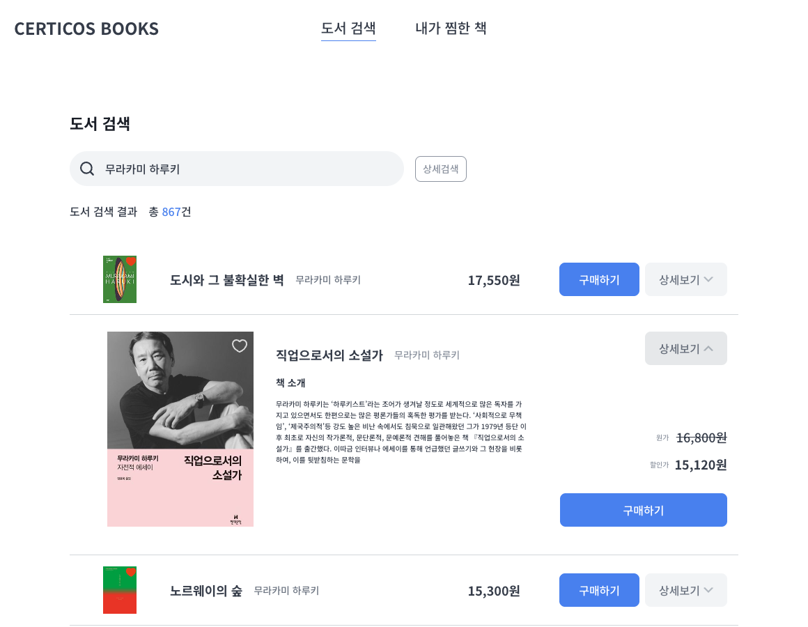
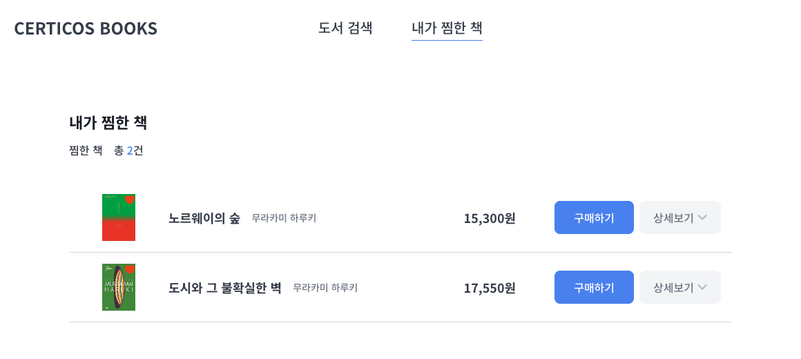
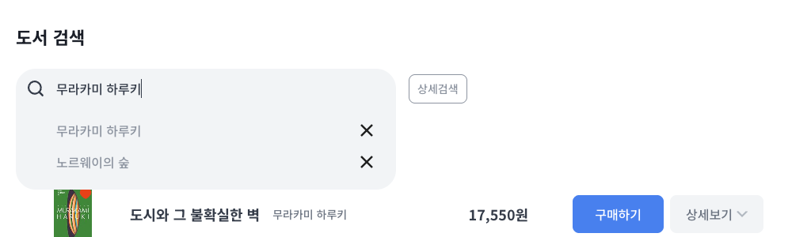
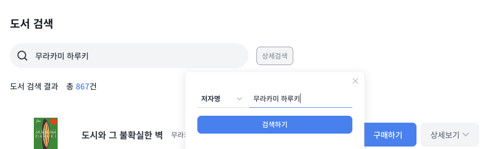
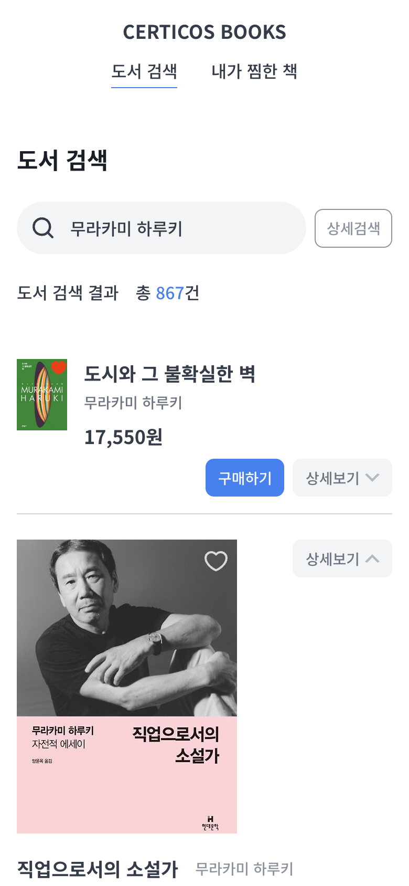

# CERTICOS BOOKS

카카오 책 검색 API로 만든 도서 검색·찜하기 서비스입니다. (CDRI 프론트엔드 사전과제)

- 지원자: 박태준
- 저장소: https://github.com/TaeJuneP/cdri-books-parktaejune

| 도서 검색 · 상세보기                      | 내가 찜한 책                                   |
| ----------------------------------------- | ---------------------------------------------- |
|  |  |

| 최근 검색어                                         | 상세검색                                        | 모바일 (390px)                                                        |
| --------------------------------------------------- | ----------------------------------------------- | --------------------------------------------------------------------- |
|  |  |  |

## 목차

1. [프로젝트 개요](#1-프로젝트-개요)
2. [실행 방법 및 환경 설정](#2-실행-방법-및-환경-설정)
3. [폴더 구조 및 주요 코드 설명](#3-폴더-구조-및-주요-코드-설명)
4. [라이브러리 선택 이유](#4-라이브러리-선택-이유)
5. [강조하고 싶은 기능](#5-강조하고-싶은-기능)
6. [시안 외에 판단한 부분](#6-시안-외에-판단한-부분)
7. [측정 결과](#7-측정-결과)
8. [디자이너와 논의하고 싶은 부분](#8-디자이너와-논의하고-싶은-부분)
9. [알려진 한계와 개선 방향](#9-알려진-한계와-개선-방향)
10. [개발 과정](#10-개발-과정)
11. [AI 활용 방식](#11-ai-활용-방식)

---

## 1. 프로젝트 개요

카카오 책 검색 API로 도서를 검색하고, 마음에 드는 책을 찜해 모아 볼 수 있는 웹 서비스입니다.

| 화면         | 기능                                                                                                    |
| ------------ | ------------------------------------------------------------------------------------------------------- |
| 도서 검색    | 검색어 입력 후 Enter로 검색, 10개씩 무한 스크롤, 상세보기(책 소개·원가/할인가), 구매하기(새 탭), 찜하기 |
| 최근 검색어  | 최대 8개, 넘치면 오래된 순으로 삭제, 브라우저 재시작 후에도 유지, 개별 삭제                             |
| 상세검색     | 제목 / 저자명 / 출판사 조건 검색, 전체 검색과 동시에 진행할 수 없음(서로 초기화)                        |
| 내가 찜한 책 | 찜한 시점의 도서 정보로 목록 표시, 10개씩 표시, 브라우저 재시작 후에도 유지                             |

**기술 스택**: Next.js 16 (App Router) · React 19 · TypeScript · TanStack Query 5 · Zustand 5 · Tailwind CSS 4 · Vitest

---

## 2. 실행 방법 및 환경 설정

### 요구 사항

| 항목    | 버전                                                          |
| ------- | ------------------------------------------------------------- |
| Node.js | **22.12 이상** (`.nvmrc`에 22로 고정)                         |
| pnpm    | `package.json`의 `packageManager`에 고정 (corepack 사용 권장) |

### 실행

```bash
# 1. 의존성 설치
corepack enable          # pnpm이 없다면 (packageManager에 고정된 버전을 사용)
pnpm install

# 2. 환경변수 설정: 메일로 전달드린 .env 파일을 프로젝트 루트에 두거나, 템플릿을 복사해 키를 입력
cp .env.example .env     # KAKAO_REST_API_KEY=발급받은_REST_API_키

# 3. 개발 서버 실행 → http://localhost:3000
pnpm dev
```

### 환경변수

| 이름                 | 설명                                                                                                                                                             |
| -------------------- | ---------------------------------------------------------------------------------------------------------------------------------------------------------------- |
| `KAKAO_REST_API_KEY` | 카카오 REST API 키. **서버(Route Handler)에서만** 읽기 때문에 `NEXT_PUBLIC_` 접두사를 붙이지 않습니다. 접두사를 붙이면 브라우저로 전달되는 JS에 키가 포함됩니다. |

### 스크립트

| 명령                                                 | 설명                                         |
| ---------------------------------------------------- | -------------------------------------------- |
| `pnpm dev`                                           | 개발 서버                                    |
| `pnpm build` / `pnpm start`                          | 프로덕션 빌드 / 실행                         |
| `pnpm test`                                          | 단위 테스트 (Vitest, 47개)                   |
| `pnpm lint` · `pnpm typecheck` · `pnpm format:check` | 정적 검사 (PR마다 GitHub Actions에서도 실행) |

---

## 3. 폴더 구조 및 주요 코드 설명

### 폴더 구조

```
src/
├── app/                    Next.js 라우트 (폴더 경로 = URL)
│   ├── page.tsx              /           도서 검색
│   ├── wishlist/page.tsx     /wishlist   내가 찜한 책
│   ├── api/books/route.ts    /api/books  BFF (서버에서 카카오 API 호출)
│   ├── layout.tsx            공통 레이아웃 (폰트, 헤더, Provider)
│   └── error.tsx · not-found.tsx
│
├── features/               도메인(기능)별 코드
│   ├── book/                 책: 데이터 모델, 카카오 호출·변환, 도서 행 UI
│   ├── search/               검색: 검색창, 상세검색, 최근 검색어, 결과 목록
│   └── wishlist/             찜: 저장소, 하트 버튼, 찜 목록
│
├── components/             특정 기능에 속하지 않는 공통 UI (Button, 아이콘, 헤더, 빈 상태)
├── hooks/                  공통 훅 (바깥 클릭·Esc 감지, 스크롤 끝 감지)
└── lib/                    공통 도구 (클래스 병합, fetch 래퍼, React Query 설정)
```

각 기능 폴더 안은 같은 규칙으로 나눴습니다.

| 하위 폴더          | 역할                                                                |
| ------------------ | ------------------------------------------------------------------- |
| `types.ts`         | 데이터 모양 (`Book`, `SearchCondition`)                             |
| `utils/`           | 순수 함수. "검색 기록은 최대 8개" 같은 **규칙**을 두고 테스트합니다 |
| `stores/`          | Zustand 저장소 (브라우저 상태)                                      |
| `hooks/`           | 데이터를 가져오거나 URL을 읽는 훅                                   |
| `api/` · `server/` | 브라우저 → BFF 호출 / 서버 전용 코드 (카카오 호출)                  |
| `components/`      | 화면                                                                |

**의존 방향**: `search`와 `wishlist`는 `book`을 import하지만, `book`은 다른 기능을 import하지 않습니다. 도서 행(`BookItem`, book)이 하트(`WishButton`, wishlist)를 직접 import하면 book과 wishlist가 서로를 import하는 순환 구조가 됩니다. 그래서 `BookItem`은 표지 위에 요소를 올릴 자리(`coverAction`)만 열어 두고, 하트는 사용하는 쪽(검색 결과, 찜 목록)에서 넣어 줍니다.

### 검색 요청 흐름

```
① SearchBar          Enter
② BookSearch         최근 검색어 저장 + search({ query })
③ useSearchCondition router.push("/?query=…")        ← 검색 = URL 변경
④ useSearchCondition URL을 읽어 검색 조건 계산
⑤ useBookSearch      React Query 캐시 확인 (같은 검색은 1분간 재요청 없음)
⑥ searchBooks        fetch("/api/books?query=…&page=1")
⑦ route.ts [서버]    입력 검증 → 카카오 호출(API 키) → Book 모델로 변환
⑧ SearchResults      페이지 합치기 + 중복 제거 후 목록 렌더링
⑨ 스크롤 끝 감지      fetchNextPage → ⑥부터 page=2
```

### 상태 관리

상태의 성격에 따라 저장 위치를 나눴습니다.

| 상태                 | 저장 위치                  | 이유                                         |
| -------------------- | -------------------------- | -------------------------------------------- |
| 검색 결과            | **React Query**            | 서버 데이터. 캐시·재시도·요청 취소가 필요    |
| 검색 조건            | **URL**                    | 새로고침·뒤로가기·링크 공유 시 유지          |
| 최근 검색어, 찜 목록 | **Zustand + localStorage** | 브라우저에만 있는 데이터. 재시작 후에도 유지 |
| 마지막 검색 위치     | **Zustand (메모리)**       | 탭 이동 후 결과 복원용 (아래 6장 참고)       |
| 펼침 여부, 팝업 열림 | **useState**               | 해당 컴포넌트에서만 쓰는 상태                |

### 주요 파일

| 파일                                            | 설명                                                                       |
| ----------------------------------------------- | -------------------------------------------------------------------------- |
| `app/api/books/route.ts`                        | BFF. 입력 검증, 오류별 상태 코드(400 / 429 / 500 / 502 / 504)              |
| `features/book/server/kakao-book-client.ts`     | 카카오 호출. `server-only`로 클라이언트 import 시 빌드 실패, 5초 제한 시간 |
| `features/book/server/kakao-book-mapper.ts`     | 카카오 응답 → `Book` 변환 (`sale_price: -1` → `null`, ISBN13 식별자 등)    |
| `features/search/hooks/use-search-condition.ts` | URL ↔ 검색 조건                                                            |
| `features/search/hooks/use-book-search.ts`      | `useInfiniteQuery` 기반 검색, 페이지 합치기·중복 제거                      |
| `features/book/components/book-item.tsx`        | 도서 행. 접힘/펼침, `memo`, 반응형 Grid                                    |
| `features/wishlist/stores/wishlist-store.ts`    | 찜 저장소, hydration 안전 훅                                               |
| `lib/query-client.ts`                           | React Query 기본 설정, 재시도 규칙                                         |

---

## 4. 라이브러리 선택 이유

| 라이브러리                      | 선택 이유                                                                                                                                                                                                                                                                                                                                                                                                                                                                |
| ------------------------------- | ------------------------------------------------------------------------------------------------------------------------------------------------------------------------------------------------------------------------------------------------------------------------------------------------------------------------------------------------------------------------------------------------------------------------------------------------------------------------ |
| **Next.js 16 (App Router)**     | 과제의 "API Key 보안"에 답하기 위해 선택했습니다. Route Handler를 BFF로 두면 카카오 API 키가 서버에만 있고 브라우저로 전달되지 않습니다. Server Action은 데이터 변경용으로 설계되어 클라이언트에서 한 번에 하나씩 순차 실행되므로(Next.js 공식 문서), 조회 전용인 검색에는 병렬 처리·요청 취소·HTTP 상태 코드를 쓸 수 있는 Route Handler를 택했습니다. 화면은 인터랙션 위주라 의도적으로 클라이언트 렌더링 중심으로 두고, 헤더·제목처럼 정적인 부분만 미리 렌더링합니다. |
| **TanStack Query** (필수)       | 검색 결과는 서버 데이터라 캐시·재시도·요청 취소가 필요합니다. `useInfiniteQuery`로 무한 스크롤의 페이지 관리를 맡겼습니다.                                                                                                                                                                                                                                                                                                                                               |
| **Zustand**                     | 최근 검색어·찜 목록은 서버와 무관한 브라우저 상태입니다. `persist` 미들웨어로 localStorage 저장을 간단히 처리하고, 선택자로 필요한 값만 구독해 불필요한 렌더링을 줄입니다. 상태 종류가 적어 Redux는 과하다고 판단했습니다.                                                                                                                                                                                                                                               |
| **Tailwind CSS 4**              | 빌드 시점에 CSS를 만들어 런타임 비용이 없고, 서버/클라이언트 컴포넌트 구분 없이 동작합니다. Emotion 같은 런타임 CSS-in-JS는 App Router에서 클라이언트 컴포넌트와 별도 설정이 필요해 제외했습니다. 시안의 색상·타이포는 `@theme` 토큰으로 등록했습니다.                                                                                                                                                                                                                   |
| **cva · clsx · tailwind-merge** | 버튼 variant를 선언적으로 관리하고, 외부에서 넘긴 클래스가 기본 스타일을 안전하게 덮어쓰게 합니다.                                                                                                                                                                                                                                                                                                                                                                       |
| **Vitest**                      | 규칙이 담긴 순수 함수(응답 변환, 가격, 검색 기록, 찜, 재시도 규칙)를 빠르게 테스트합니다.                                                                                                                                                                                                                                                                                                                                                                                |

**쓰지 않은 것**

| 대상              | 이유                                                                                                                                   |
| ----------------- | -------------------------------------------------------------------------------------------------------------------------------------- |
| 아이콘 라이브러리 | 필요한 아이콘이 4종뿐이라, 시안 PDF의 벡터 경로와 Figma SVG를 그대로 인라인 컴포넌트로 만들었습니다.                                   |
| 커스텀 Select     | 시안에 옵션 목록 디자인이 없어, 키보드·스크린리더·모바일 선택 UI를 브라우저가 보장하는 네이티브 `<select>`에 시안 스타일을 입혔습니다. |
| axios             | BFF 호출 하나뿐이라 `fetch` 래퍼(`lib/http.ts`)로 충분했습니다.                                                                        |

---

## 5. 강조하고 싶은 기능

### 1) BFF로 API 키 보호

브라우저는 `/api/books`만 호출하고, 카카오 API는 서버가 호출합니다.

- 카카오 호출 모듈에 `import "server-only"`를 두어, 실수로 클라이언트에서 import하면 **빌드가 실패**합니다.
- 프로덕션 빌드 결과물(`.next/static`)에서 API 키와 카카오 주소가 **0건**인 것을 확인했습니다.
- 입력 검증과 오류 구분(빈 검색어 400, 호출량 초과 429, 카카오 오류 502, **응답 지연 504**)으로 화면에서 상황에 맞는 안내를 보여줍니다.

### 2) 검색 조건은 URL에만

검색은 "상태를 바꾸는 것"이 아니라 "URL을 바꾸는 것"입니다. 덕분에

- 새로고침·뒤로가기·링크 공유 시 검색 결과가 유지됩니다.
- **전체 검색과 상세검색의 상호 초기화**가 별도 동기화 코드 없이 해결됩니다. 상세검색을 하면 URL에 `target`이 생기고, 전체 검색을 하면 사라지기 때문입니다.

### 3) 찜 목록의 hydration 문제 해결

`/wishlist`는 서버에서 미리 렌더링되는데, 서버는 localStorage를 읽을 수 없어 "0건"으로 그립니다.

| 방법                                                 | 결과                                                           |
| ---------------------------------------------------- | -------------------------------------------------------------- |
| 아무 처리 없음                                       | hydration 에러                                                 |
| 저장소 복원을 마운트 이후로 지연                     | 에러는 없지만 **"찜한 책이 없습니다"가 잠깐 보였다 사라짐**    |
| **`useSyncExternalStore`의 서버 스냅샷 = "복원 전"** | hydration 시점엔 서버와 같은 상태(스켈레톤), 직후 실제 목록 ✅ |

서버가 보내는 HTML에 빈 상태 문구가 없고 스켈레톤만 있는 것을 확인해, 깜빡임이 구조적으로 생기지 않게 했습니다.

### 4) 실패에 강한 무한 스크롤

- TanStack Query v5는 다음 페이지 요청이 실패하면 쿼리 전체 `status`를 `'error'`로 바꿉니다. `status`로 화면을 분기하면 이미 보던 목록이 에러 화면으로 바뀝니다. **데이터 유무로 분기**해 기존 목록은 유지하고 하단에서만 재시도를 안내합니다.
- 재시도 규칙: 4xx는 다시 보내도 결과가 같아 재시도하지 않고, 429·5xx·네트워크 오류만 1회 재시도합니다. (응답을 가로채 측정: 400 → 1회, 429·502 → 2회)

### 5) 실제 데이터에서 발견한 문제 대응

- **ISBN 중복**: 카카오 DB에 ISBN은 같고 등록만 다른 문서가 있어("가" 검색 100건 중 4건) React key 충돌이 났습니다. 같은 책이 두 줄로 보이지 않도록 모든 페이지를 합친 뒤 중복을 제거합니다.
- **썸네일 해상도**: 기본 썸네일(120px)은 상세보기 표지(210px)에 쓰기엔 흐립니다. 카카오 CDN의 리사이즈 파라미터를 활용하되, **허용된 크기 외에는 403**이라(실측) 허용 크기 중에서 고르는 `next/image` 커스텀 loader를 만들었습니다.

### 6) 시안 재현과 반응형

- 시안 PDF에서 색상·크기·간격을 추출해 토큰으로 등록하고, 1920px 화면에서 측정값이 시안과 일치하는 것을 확인했습니다. (펼친 행 높이 345px, 표지 x=534, 구매하기 240px 등)
- 시안은 데스크톱만 있어, 1024px 미만에서는 배치를 바꿨습니다. **요소를 화면별로 두 벌 두고 숨기지 않고** CSS Grid 배치만 바꿔, 스크린리더가 같은 버튼을 두 번 읽거나 포커스 순서가 꼬이지 않게 했습니다.

### 7) 접근성

- 상세보기 `aria-expanded`, 찜하기 `aria-pressed`, 활성 메뉴 `aria-current`, 검색 영역 `role="search"`
- 키보드: 최근 검색어 ↑/↓·Esc, 팝업 Esc로 닫기, 접힘/펼침 시 버튼이 다시 그려져도 **포커스 유지**
- 목록 하트(16px)의 누를 수 있는 영역을 24px로 확대 (WCAG 2.5.8)
- 글자 크기는 rem으로 지정해 사용자의 브라우저 글꼴 크기 설정을 따릅니다.

---

## 6. 시안 외에 판단한 부분

시안에 정의되지 않았거나 시안끼리 다른 부분은 아래처럼 판단했습니다.

| 항목                   | 판단                                    | 이유                                                                                                |
| ---------------------- | --------------------------------------- | --------------------------------------------------------------------------------------------------- |
| 구매하기 이동 위치     | 다음 책 상세 페이지                     | 시안 주석이 "네이버 책"과 "다음 책"으로 서로 달라, 카카오 API가 제공하는 `url`(다음 책)을 사용      |
| 검색창 placeholder     | "검색어를 입력하세요"                   | 주석('검색어 입력')과 화면이 달라 화면을 따름. '검색어 입력'은 상세검색 입력창에 사용               |
| 목록의 가격            | 할인가가 있으면 할인가, 없으면 정가     | 실제 판매가를 보여주는 것이 자연스러움                                                              |
| 탭 이동 후 돌아오기    | **검색 결과 유지**                      | 탭은 '화면 전환'이지 '초기화'가 아님. 결과는 캐시에서 바로 표시(API 호출 0회). 로고를 누르면 초기화 |
| 상세검색과 최근 검색어 | 상세검색은 기록하지 않음                | 시안상 최근 검색어는 '검색창'의 기능                                                                |
| 상세보기               | 여러 행을 동시에 펼칠 수 있음           | 여러 책을 비교하기 쉬움                                                                             |
| GNB 메뉴 위치          | 화면 중앙 정렬                          | 시안은 중앙에서 약 75px 왼쪽이지만, 화면 폭이 바뀌어도 일관되도록 중앙 정렬                         |
| 모바일 버튼 정렬       | 오른쪽 정렬                             | 데스크톱·펼친 행과 버튼 위치를 맞춤                                                                 |
| 하트 색                | Figma 원본 기준(찜 안 함 = 회색 테두리) | PDF 시안(흰색)과 달라 Figma 원본을 따름                                                             |
| 에러·404 화면          | 추가                                    | 예상치 못한 오류에도 헤더를 유지한 채 안내                                                          |

---

## 7. 측정 결과

### Lighthouse (프로덕션 빌드)

| 페이지                    | 데스크톱 성능 | 모바일 성능 | 접근성 | 권장사항 | CLS |
| ------------------------- | ------------- | ----------- | ------ | -------- | --- |
| `/`                       | 100           | 91          | 96     | 100      | 0   |
| `/?query=무라카미 하루키` | 100           | 89          | 96     | 100      | 0   |
| `/wishlist`               | 100           | 91          | 100    | 100      | 0   |

- 접근성 감점은 모두 시안 브랜드 색의 대비 문제입니다. (8장 참고)
- 모바일 성능은 Lighthouse의 느린 4G 시뮬레이션 기준입니다.

### 렌더링 최적화

무한 스크롤로 다음 페이지를 불러올 때 이미 그려진 행까지 다시 렌더링되고 있었습니다. 렌더링 횟수를 측정해 확인한 뒤 `BookItem`에 `memo`를 적용하고, 렌더마다 새로 만들어져 `memo`를 무력화하던 함수 prop을 모듈 수준의 고정 함수로 바꿨습니다.

| 상황                         | 수정 전 | 수정 후                        |
| ---------------------------- | ------- | ------------------------------ |
| 다음 페이지 로드 (10 → 20행) | 60회    | **20회** (새 10행만)           |
| 하트 클릭                    | 0회     | 0회 (해당 책의 찜 여부만 구독) |

※ 개발 모드 StrictMode의 이중 렌더링 포함 수치

### 시도했지만 채택하지 않은 것

모바일 LCP의 주된 원인이 렌더링을 막는 CSS로 나와 `experimental.inlineCss`를 시도했지만, **모바일 성능이 오히려 하락**(89~91 → 86~90)했습니다. 분석해 보니 CSS 99KB 중 **79%가 한글 폰트(Noto Sans KR)를 나눠 받기 위한 `@font-face` 선언 125개**라, HTML에 넣으면 HTML이 무거워졌습니다. 측정 근거로 되돌렸습니다. (gzip 전송량은 31KB)

---

## 8. 디자이너와 논의하고 싶은 부분

일부 브랜드 색이 WCAG AA 글자 대비 기준(4.5:1)에 못 미칩니다. 브랜드 색은 디자인 시스템의 결정이라 임의로 바꾸지 않고 시안대로 구현했으며, 기준을 충족하는 대안을 함께 정리했습니다.

| 요소                                         | 현재 대비 | 기준 충족 대안        |
| -------------------------------------------- | --------- | --------------------- |
| 구매하기 버튼, 검색 건수 (Primary `#4880EE`) | 3.75 : 1  | `#4173D6` (명도 -10%) |
| 상세보기 버튼 (Text Secondary on LightGray)  | 4.21 : 1  | `#69707D` (명도 -4%)  |
| 상세검색 버튼 (Text Subtitle `#8D94A0`)      | 3.05 : 1  | `#717680` (명도 -20%) |

---

## 9. 알려진 한계와 개선 방향

| 항목                  | 현재                                                   | 개선 방향                                                                          |
| --------------------- | ------------------------------------------------------ | ---------------------------------------------------------------------------------- |
| 찜 목록 저장          | 브라우저 localStorage (기기별, 사용자가 지우면 사라짐) | 로그인과 찜 API(서버 DB). localStorage는 비로그인 임시 저장에만 사용               |
| BFF 응답 검증         | 타입만 선언, 런타임 검증 없음                          | 외부 응답을 직접 받는 경우 zod 등으로 런타임 검증                                  |
| 찜 목록에서 하트 해제 | 해당 책이 목록에서 사라지며 키보드 포커스를 잃음       | 다음 항목으로 포커스 이동, 실행 취소(Undo) 제공                                    |
| 상세검색 팝업         | 화면을 막지 않는 팝업이라 포커스를 가두지 않음         | 모달로 바꾼다면 포커스 트랩 적용                                                   |
| 탭 이동 후 돌아오기   | 결과는 유지되지만 스크롤 위치는 맨 위                  | 스크롤 위치 복원                                                                   |
| 레이아웃 박스 크기    | 시안 재현을 위해 일부 높이를 px로 고정                 | 고정 높이 대신 padding으로 잡아 큰 글꼴 설정에 더 유연하게 대응                    |
| 테스트                | 순수 함수 단위 테스트 47개                             | 화면 시나리오(E2E) 테스트를 CI에 추가. 개발 중에는 Headless Chrome 스크립트로 검증 |

---

## 10. 개발 과정

### 브랜치 전략

`main` ← `develop` ← `feature/*`, `fix/*`, `chore/*`, `style/*`

- 기능 단위 브랜치에서 작업하고 PR로 `develop`에 머지했습니다. (merge commit으로 커밋 단위 유지)
- 커밋은 [Conventional Commits](https://www.conventionalcommits.org/ko/v1.0.0/) 형식(`feat:`, `fix:`, `refactor:` …)이며, 본문에 **왜** 바꿨는지를 적었습니다.

### CI

PR과 push마다 GitHub Actions에서 `lint → format:check → typecheck → test → build`를 실행합니다. 도입 직후, 로컬에서는 이전 빌드 결과물 덕분에 통과하던 타입 검사가 깨끗한 환경에서 실패하는 문제를 잡았습니다.

### Pull Request 목록

| PR  | 내용                                                              |
| --- | ----------------------------------------------------------------- |
| #1  | 카카오 책 검색 BFF와 도서 도메인 모델                             |
| #2  | 공통 UI 컴포넌트와 GNB 레이아웃                                   |
| #3  | 도서 검색 (검색창, 결과 목록, 상세보기, 무한 스크롤)              |
| #4  | 최근 검색어 (최대 8개, 브라우저 재시작 후 유지)                   |
| #5  | 목록 썸네일의 next/image loader 경고 수정                         |
| #6  | 상세검색 팝업과 전체/상세 검색 상호 초기화                        |
| #7  | 찜하기와 내가 찜한 책 페이지                                      |
| #8  | 마무리 점검 (반응형, 성능, 예외 화면)                             |
| #9  | 탭 이동 후 돌아와도 검색 결과 유지                                |
| #10 | 모바일·태블릿에서 도서 행 버튼 우측 정렬                          |
| #11 | 4xx 에러 재시도 제외                                              |
| #12 | 코드 리뷰 후속 수정 (로딩 건수, 카카오 시간 초과, 하트 터치 영역) |

각 PR에는 변경 이유, 설계 결정, 검증 방법과 결과를 기록했습니다.

---

## 11. AI 활용 방식

과제 안내에 따라 AI 활용 방식을 투명하게 밝힙니다. 이 프로젝트는 **Claude Code와 페어 프로그래밍** 방식으로 개발했습니다.

**AI에게 맡긴 것**

- 시안 PDF 수치 추출, 코드 초안 작성, 테스트 작성
- Headless Chrome 스크립트를 이용한 화면·동작 검증, Lighthouse 측정

**직접 정한 것**

- **커밋 규칙**: Conventional Commits에서 scope를 쓰지 않기로 했습니다. 협업에서는 변경이 여러 영역에 걸치는 경우가 많아 scope 기준이 흔들리기 쉽고, 지켜지지 않는 규칙은 오히려 히스토리를 어지럽힌다고 판단했습니다.
- **브랜치 전략**: `main` / `develop` / `feature` 구조와 기능 단위 PR로 진행했습니다. 혼자 하는 과제지만 실무 협업 방식대로 작업 단위와 변경 이유를 PR에 남기기 위해서입니다.
- **사용성 판단**
  - 찜 목록에 다녀오면 검색 결과가 사라지는 문제를 제기하고, 탭은 '초기화'가 아닌 '화면 전환'이라는 기준으로 결과를 유지하기로 했습니다.
  - 모바일에서 도서 행 버튼을 오른쪽으로 정렬하자고 제안했습니다.
  - 상세보기 다중 펼침, GNB 메뉴 중앙 정렬, 브랜드 색 유지(대비 문제는 문서화)를 결정했습니다.
- **직접 사용하며 발견한 문제**: 특정 검색어로 스크롤할 때 발생한 key 중복 에러를 찾아 원인 분석과 수정으로 이어졌습니다.

**AI의 제안을 검토해 정한 설계**

- **Next.js 채택**: 과제 필수 스택이 React라 Next.js가 감점 요인이 될지 먼저 따졌습니다. "회사가 쓰니까"가 아니라 BFF로 API 키를 숨긴다는 기술적 근거가 있을 때만 의미가 있다고 보고 채택했습니다.
- **스타일링**: Emotion과 Tailwind를 비교해, App Router 호환성과 런타임 비용을 기준으로 Tailwind를 골랐습니다.
- **DDD·TDD 적용 범위**: 전면 적용은 이 규모에서 과설계라고 보고, DDD는 기능 단위 폴더 구조와 API 응답/도메인 모델 분리로, TDD는 규칙이 담긴 순수 함수의 단위 테스트로 범위를 좁혔습니다.
- **오류 처리**: 다시 보내도 결과가 같은 4xx는 재시도하지 않기로 했고, 코드 리뷰에서 나온 후속 수정(로딩 중 건수, 카카오 시간 초과, 하트 터치 영역)을 진행하기로 했습니다.

모든 PR은 변경 내용과 검증 결과를 확인한 뒤 직접 머지했습니다.

**검증 원칙**

- AI가 작성한 코드는 "테스트 통과"에서 멈추지 않고 실제 동작으로 확인했습니다. 예를 들어 썸네일 loader는 단위 테스트를 통과했지만 실제 CDN에서 403이 나는 것을 확인해 다시 고쳤습니다.
- 개발 모드에서만 보이는 현상은 프로덕션 빌드로 재현해 원인을 분리했습니다.
- 코드 전체 구조와 동작 원리를 정리한 문서로 직접 학습하며 리뷰했습니다.
